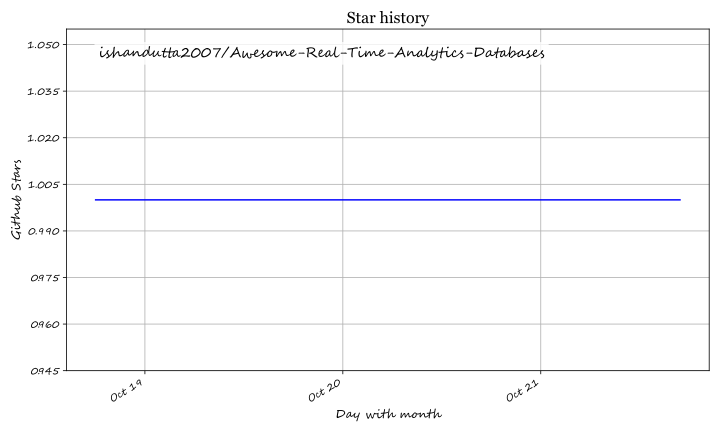

<div align="center">

<p align="center">
  
</p>

# ⚡ Awesome Real-Time Analytics Databases 🚀

### *The Definitive Curated Guide to Sub-Second OLAP Engines, Streaming Ingestion & High-Concurrency Analytics*

<p align="center">
  <a href="https://github.com/ishandutta2007/Awesome-Awesome-Awesome"></a>
  <a href="https://discord.gg/jc4xtF58Ve"></a>
  <a href="LICENSE"></a>
  <a href="https://github.com/ishandutta2007/Awesome-Real-Time-Analytics-Databases/pulls"></a>
  <a href="https://github.com/ishandutta2007/Awesome-Real-Time-Analytics-Databases/stargazers"></a>
  <a href="https://github.com/ishandutta2007"></a>
</p>

<p align="center">
  <strong>A community-maintained index of open-source analytical databases, streaming engines, and managed SaaS platforms engineered to process and query massive data streams in sub-second latency.</strong>
</p>

</div>

---

## 📑 Table of Contents

- [🔍 Overview](#-overview)
- [🌐 Sector Overview & Market Dynamics](#-sector-overview--market-dynamics)
- [🏢 SaaS & Hosted Platforms](#-saas--hosted-platforms)
- [🛠️ Open-Source GitHub Projects](#️-open-source-github-projects)
- [⚖️ Architectural Decision Matrix](#️-architectural-decision-matrix)
- [🤝 How to Contribute](#-how-to-contribute)
- [⭐ Star History](#star-history)
- [💖 Support & Community](#-support--community)
- [📜 Disclaimer & License](#-disclaimer--license)

---

## 🔍 Overview

**Real-Time Analytics Databases** (also known as real-time OLAP datastores) are specialized systems engineered for **low-latency ingestion** and **sub-second analytical queries** over billions to trillions of rows. Unlike traditional operational databases (OLTP) or batch-oriented cloud warehouses, these engines ingest real-time streams (Apache Kafka, AWS Kinesis, CDC pipelines) and answer aggregate analytical queries with high concurrency—enabling live operational dashboards, real-time telemetry, fraud detection, and customer-facing analytics.

### 🎯 Key Capabilities
- **⚡ Sub-Second Query Latencies (P95/P99 < 100ms):** Columnar storage formats, vectorized SIMD execution engines, and multi-tier indexing.
- **🌊 Streaming Ingestion:** Direct zero-copy consumers for Kafka, Redpanda, Pulsar, and Change Data Capture (CDC).
- **🛡️ Massive Concurrency:** Capable of serving 10,000 to 100,000+ queries per second (QPS) directly to external users.
- **🔄 Mutable Event Streaming:** Modern real-time engines support primary key upserts and deduplication at line rate.

---

## 🌐 Sector Overview & Market Dynamics

The global real-time analytics and real-time database market is currently estimated between **$21 billion and $43 billion**, with projections indicating rapid expansion past **$150B–$220B by 2032**, exhibiting a robust compound annual growth rate (CAGR) of 13% to 26%.

Market concentration exhibits a **bifurcated hybrid structure: top-heavy cloud consolidation coupled with extensive technological fragmentation**:
- **Consolidated Hyperscaler Tier:** Global cloud providers (AWS, Microsoft Azure, Google Cloud) command substantial macro-level enterprise market spend by bundling raw storage and generic data warehouse offerings into existing enterprise agreements.
- **Highly Fragmented Database Tier:** At the specialized database and streaming engine level, the ecosystem is **deeply fragmented and fiercely competitive**. Because sub-second query latency, continuous streaming ingestion, complex multi-table joins, and high-concurrency user-facing workloads impose divergent architectural trade-offs, **no single vendor enjoys a "winner-take-all" monopoly**. Instead, specialized open-source OLAP engines (e.g., ClickHouse, Apache Pinot, Apache Druid, StarRocks) and purpose-built SaaS layers capture dominant market share in their respective performance niches.

---

## 🏢 SaaS & Hosted Platforms

The following hosted and managed SaaS solutions provide production-grade real-time analytical capabilities with zero cluster operational burden. 

*The table below is sorted in descending order by **Company Scale (Valuation / Revenue / Market Cap)**.*

| Platform | Company Scale (Valuation / ARR) | Starting Price (Specific Tiers) | Free Tier / Trial Limits | Key Architecture & Target Use Case |
| :--- | :--- | :--- | :--- | :--- |
| **[Amazon Redshift](https://aws.amazon.com/redshift/)** 🏢 | **~$2.1 Trillion** Market Cap (AWS ARR ~$105B+) | **$0.25/hour** (`dc2.large` provisioned) or **$0.375/RPU-hour** (Serverless, min 8 RPUs = $3.00/query-hour) | **2-Month Free Trial:** 750 free hours/month of `dc2.large` node (continuous compute) + 160 GB SSD storage | Cloud-native data warehouse with Redshift Serverless and AQUA hardware-accelerated caching. Best for AWS-native enterprise analytics. |
| **[Snowflake](https://www.snowflake.com/)** ❄️ | **~$48 Billion** Market Cap (ARR ~$3.6B+) | **$2.00/credit** (Standard Edition; X-Small warehouse = 1 credit/hour = $2.00/hour) | **30-Day Free Trial:** $400 in free usage credits across compute warehouses and cloud storage | Interactive Warehouses & Interactive Tables delivering sub-second queries with 9x higher QPS for customer-facing applications. |
| **[ClickHouse Cloud](https://clickhouse.com/cloud)** ⚡ | **~$2.0B – $4.0B** Valuation ($300M+ venture funding) | **$0.125/unit-hour** (~$67/month for entry development instance with auto-scaling to zero; Scale tier starts at ~$500/month) | **30-Day Free Trial:** $300 in free usage credits; single replica, up to 1 TB storage (no permanent free tier) | Serverless managed ClickHouse with separated compute and object storage, dynamic scaling, and extreme single-table query speed. |
| **[SingleStore Helios](https://www.singlestore.com/)** 🚀 | **~$1.3 Billion** Peak Valuation ($120M+ ARR; Vector Capital majority) | **$0.99/hour** for dedicated `S-00` workspace (2 vCPU, 16 GB RAM) + $0.023/GB/month storage | **Free Forever Tier:** Shared workspace with up to 1 GB compressed storage (~4 GB raw), vector search, and community support | Distributed HTAP database uniting real-time transactional (OLTP) and analytical (OLAP) processing with native MySQL wire compatibility. |
| **[Imply Polaris](https://imply.io/)** 🌲 | **~$1.1 Billion** Valuation ($215M+ funding, Series D) | **$100/month** for Starter Tier (up to 25 GB storage) or **$0.28/PPU-hour** (Polaris Processing Unit) | **30-Day Free Trial:** $500 free usage credits with ingestion fees waived; 1 project per region (Starter, A.01, D.04 sizes) | Fully-managed Apache Druid DBaaS built by Druid's original creators. Optimized for high-throughput streaming events and operator drill-downs. |
| **[StarTree Cloud](https://startree.ai/)** 🍷 | **~$297 Million** Valuation ($75M+ funding, Series B) | **$999/month** (Standard Tier: 5 STUs = 20 vCPUs, 80 GiB RAM + 1 TB storage) or **$0.11/hr/vCPU** (BYOC) | **Free Forever Tier:** 100 GB storage, burst capacity up to 10 vCPUs, single AZ deployment for dev/prototyping | Fully-managed Apache Pinot for user-facing applications serving 100k+ QPS with pluggable indexing and real-time upsert support. |
| **[Tinybird](https://www.tinybird.co/)** 🐦 | **~$250 Million** Valuation ($67M+ funding, Series B) | **$25/month** Developer Plan (0.25 vCPU baseline, 25 GB storage included, $0.058/GB for extra storage) | **Free Forever "Build" Plan:** 10 GB storage, 1,000 API requests/day, 0.25 shared vCPU (~300 vCPU-hrs/month), 10 QPS cap | Serverless ClickHouse engine with instant SQL-to-REST API generation, dynamic materialized views, and developer-centric workflows. |

---

## 🛠️ Open-Source GitHub Projects

The following open-source real-time analytical database engines power real-time data architectures worldwide. 

*Each project includes its live GitHub stargazer badge linking directly to its stargazers page. Repositories are sorted in descending order by **GitHub_Stars**.*

---

### 1. [ClickHouse](https://github.com/ClickHouse/ClickHouse) [](https://github.com/ClickHouse/ClickHouse/stargazers) ⚡
- **License:** Apache 2.0
- **Primary Language:** C++
- **Key Architecture:** Column-oriented storage with SIMD-vectorized query execution and sparse primary indexing.
- **Core Strengths:** World-class raw scan speeds on wide denormalized event tables; extreme data compression (often 5x–10x); first-class Kafka and CDC integrations.
- **Trade-offs:** Joins across multiple massive tables are non-trivial and require deliberate broadcast/distributed dictionary design; mutations are asynchronous/eventually consistent.
- **Best For:** High-volume event logging, clickstream analysis, Web3 telemetry, and cost-efficient petabyte-scale aggregations.

---

### 2. [DuckDB](https://github.com/duckdb/duckdb) [](https://github.com/duckdb/duckdb/stargazers) 🦆
- **License:** MIT
- **Primary Language:** C++
- **Key Architecture:** In-process columnar vectorized analytical database (the "SQLite for OLAP").
- **Core Strengths:** Zero external dependencies; instant startup; executes complex SQL directly on Parquet, Iceberg, Arrow, and CSV files; seamless Python/R DataFrame integration.
- **Trade-offs:** Single-node embedded architecture; not intended for high-concurrency client-server distributed serving.
- **Best For:** Local data science, embedded operational analytics, microservice data pipelines, and serverless data functions.

---

### 3. [TimescaleDB](https://github.com/timescale/timescaledb) [](https://github.com/timescale/timescaledb/stargazers) ⏰
- **License:** Apache 2.0 / Timescale License (TSL)
- **Primary Language:** C
- **Key Architecture:** PostgreSQL extension converting Postgres into a scalable time-series and real-time analytical store via automated "Hypertables".
- **Core Strengths:** 100% full PostgreSQL ecosystem and SQL compatibility; continuous aggregates; columnar compression for historical time-series partitions.
- **Trade-offs:** Horizontal scaling beyond single instances requires specialized configuration; raw scan speed on wide tables is generally lower than purpose-built columnar engines.
- **Best For:** IoT telemetry, financial market feeds, industrial sensor tracking, and teams heavily committed to PostgreSQL tooling.

---

### 4. [VictoriaMetrics](https://github.com/VictoriaMetrics/VictoriaMetrics) [](https://github.com/VictoriaMetrics/VictoriaMetrics/stargazers) 📈
- **License:** Apache 2.0
- **Primary Language:** Go
- **Key Architecture:** Ultra-efficient time-series database and monitoring solution supporting Prometheus, InfluxDB, and Graphite wire protocols.
- **Core Strengths:** Extremely low RAM and CPU usage footprint; exceptional compression ratios; high ingestion rates on high-cardinality metric streams.
- **Trade-offs:** Primarily tailored for time-series metrics rather than general-purpose arbitrary relational SQL analytics.
- **Best For:** Kubernetes monitoring, SecOps telemetry, Prometheus long-term storage, and high-cardinality observability.

---

### 5. [QuestDB](https://github.com/questdb/questdb) [](https://github.com/questdb/questdb/stargazers) 🚀
- **License:** Apache 2.0
- **Primary Language:** Java / C++
- **Key Architecture:** High-performance columnar database with zero-GC memory allocation and SIMD-optimized query compilation.
- **Core Strengths:** InfluxDB Line Protocol (ILP) ingestion at millions of rows/sec; SQL augmented with time-series language extensions (`SAMPLE BY`, `LATEST ON`).
- **Trade-offs:** More constrained ecosystem compared to Postgres-based engines; primarily single-node architecture with enterprise clustering.
- **Best For:** High-frequency trading, financial market analytics, gaming telemetry, and real-time sensor streams.

---

### 6. [Apache Doris](https://github.com/apache/doris) [](https://github.com/apache/doris/stargazers) 🐘
- **License:** Apache 2.0
- **Primary Language:** C++ / Java
- **Key Architecture:** MPP (Massively Parallel Processing) analytical database featuring columnar storage and cost-based query optimization.
- **Core Strengths:** Native MySQL protocol compatibility; exceptional distributed multi-table JOIN performance; real-time upsert via unique key data models.
- **Trade-offs:** Higher infrastructure resource footprint compared to lightweight engines; operational overhead for distributed cluster coordinators.
- **Best For:** Interactive multi-dimensional reporting, ad-hoc BI querying over star/snowflake schemas, and unified lakehouse querying.

---

### 7. [Apache Druid](https://github.com/apache/druid) [](https://github.com/apache/druid/stargazers) 🌲
- **License:** Apache 2.0
- **Primary Language:** Java
- **Key Architecture:** Distributed, streaming-first OLAP datastore with column-oriented segment files and embedded bitmap indexing.
- **Core Strengths:** Native, resilient Kafka/Kinesis stream ingestion with exactly-once semantics; instantaneous roll-ups; interactive sub-second slice-and-dice for operational dashboards.
- **Trade-offs:** Multi-component distributed topology (Brokers, Historicals, MiddleManagers, Coordinators, Deep Storage) requires dedicated operations; complex joins are slower.
- **Best For:** Operational dashboards, APM telemetry, network analytics, and high-velocity time-series event monitoring.

---

### 8. [StarRocks](https://github.com/StarRocks/starrocks) [](https://github.com/StarRocks/starrocks/stargazers) 🌊
- **License:** Apache 2.0
- **Primary Language:** C++ / Java
- **Key Architecture:** Next-generation vectorized MPP analytical database with a Cost-Based Optimizer (CBO) and automated materialized views.
- **Core Strengths:** Superior distributed multi-table JOIN performance on complex queries; native zero-copy querying on Apache Iceberg, Hudi, and Delta Lake; real-time primary key upserts.
- **Trade-offs:** Cluster deployment requires distinct Frontend (FE) and Backend (BE) components; relatively younger operational ecosystem than ClickHouse.
- **Best For:** Real-time data lakehouse acceleration, interactive BI dashboards with intricate multi-table joins, and high-throughput real-time updates.

---

### 9. [RisingWave](https://github.com/risingwavelabs/risingwave) [](https://github.com/risingwavelabs/risingwave/stargazers) 🌊
- **License:** Apache 2.0
- **Primary Language:** Rust
- **Key Architecture:** Distributed SQL streaming database using incremental materialized view computation with S3/object-storage-backed state.
- **Core Strengths:** PostgreSQL wire compatibility; continuous stream processing written in standard SQL; decoupled compute and cloud object storage.
- **Trade-offs:** Best suited for continuous incremental computations and materialized transformations rather than cold arbitrary full-table scans.
- **Best For:** Real-time feature stores, streaming ETL, dynamic alerting, and continuously updated materialized views.

---

### 10. [GreptimeDB](https://github.com/GreptimeTeam/greptimedb) [](https://github.com/GreptimeTeam/greptimedb/stargazers) 🦎
- **License:** Apache 2.0
- **Primary Language:** Rust
- **Key Architecture:** Cloud-native distributed time-series database with hybrid columnar/row storage, built on Apache Arrow and DataFusion.
- **Core Strengths:** Written in Rust for memory safety; unified support for metrics, logs, and traces; PromQL and SQL dual-query interface.
- **Trade-offs:** Emerging project with evolving operational tooling compared to decade-old incumbents.
- **Best For:** Observability platforms, industrial IoT telemetry, and cloud-native time-series workloads.

---

### 11. [Materialize](https://github.com/MaterializeInc/materialize) [](https://github.com/MaterializeInc/materialize/stargazers) 🔮
- **License:** Business Source License (BSL 1.1)
- **Primary Language:** Rust
- **Key Architecture:** Streaming database powered by Timely Dataflow and Differential Dataflow for incremental view maintenance.
- **Core Strengths:** Complete ANSI SQL support on continuous data streams; sub-second answers to complex join-heavy materialized views.
- **Trade-offs:** Non-permissive BSL source license; compute-heavy state maintenance for extremely wide stateful joins.
- **Best For:** Real-time business intelligence, dynamic pricing engines, automated fraud detection, and instant notification pipelines.

---

### 12. [Apache Pinot](https://github.com/apache/pinot) [](https://github.com/apache/pinot/stargazers) 🍷
- **License:** Apache 2.0
- **Primary Language:** Java
- **Key Architecture:** Distributed real-time OLAP datastore with multi-tier indexing (Star-Tree, inverted, forward, Bloom filter, JSON, geospatial).
- **Core Strengths:** Engineered specifically for ultra-high QPS (100k+ queries/second) user-facing applications; sub-second P99 latencies; real-time upsert support.
- **Trade-offs:** Data modeling requires upfront indexing decisions; general ad-hoc exploratory joins are more restricted without co-located partitions.
- **Best For:** Customer-facing analytical features (e.g., LinkedIn "Who Viewed My Profile", UberEats Merchant Analytics), live in-app user metrics.

---

### 13. [Apache Kylin](https://github.com/apache/kylin) [](https://github.com/apache/kylin/stargazers) 🧊
- **License:** Apache 2.0
- **Primary Language:** Java
- **Key Architecture:** Distributed analytical engine using pre-aggregation multidimensional OLAP (MOLAP) cube technology over massive datasets.
- **Core Strengths:** Sub-second query response on petabyte-scale datasets by pre-calculating cube aggregations; ANSI SQL interface with BI tool integrations.
- **Trade-offs:** High pre-computation batch cost; less adaptable to unpredictable ad-hoc queries outside defined cube dimensions.
- **Best For:** Enterprise BI reporting, massive historical multidimensional aggregations, and Hadoop/Spark data lake acceleration.

---

### 14. [ByConity](https://github.com/ByConity/ByConity) [](https://github.com/ByConity/ByConity/stargazers) 🌐
- **License:** Apache 2.0
- **Primary Language:** C++
- **Key Architecture:** Cloud-native analytical engine branched from ClickHouse with complete storage-compute separation and distributed transaction support.
- **Core Strengths:** Shared-storage architecture (HDFS/S3); multi-tenant workload isolation; elastic autoscaling without data rebalancing.
- **Trade-offs:** Forked from ClickHouse codebase, maintaining its own separate release cadence and feature trajectory.
- **Best For:** Large-scale multi-tenant enterprise data platforms and elastic cloud-native ClickHouse deployments.

---

## ⚖️ Architectural Decision Matrix

Choosing the right real-time database requires balancing query complexity, concurrency targets, and data freshness requirements:

```
                                 ▲ HIGH CONCURRENCY (>50K QPS)
                                 │
                                 │    🍷 Apache Pinot
                                 │       (User-Facing Apps)
                                 │
                                 │    ⚡ ClickHouse
                                 │       (Fast Scans / Wide Tables)
    COMPLEX MULTI-TABLE JOINS    │                                     SINGLE-TABLE SCAN SPEED
    ◄────────────────────────────┼────────────────────────────────────────────────────────────►
     🌊 StarRocks                │    🌲 Apache Druid
     🐘 Apache Doris             │       (Time-Series / Slicing)
     🔮 Materialize              │
                                 │    🦆 DuckDB
                                 │       (Embedded / In-Process)
                                 ▼
                                 LOW CONCURRENCY / AD-HOC BI
```

| Evaluation Factor | Recommended Technologies | Architectural Justification |
| :--- | :--- | :--- |
| **High-QPS User-Facing Analytics** | **Apache Pinot**, **ClickHouse Cloud** | Pluggable Star-Tree indexing, co-located partition joins, and sub-100ms P99 latencies at 100k+ QPS. |
| **Extreme Scan Speed & Low $/TB** | **ClickHouse**, **QuestDB** | Vectorized SIMD execution engines, sparse primary keys, and industry-leading compression ratios (up to 10x). |
| **Complex Multi-Table JOINs & Lakehouse** | **StarRocks**, **Apache Doris** | Advanced Cost-Based Optimizers (CBO), distributed broadcast/shuffle joins, and native Apache Iceberg/Hudi queries. |
| **Streaming ETL & Continuous SQL** | **RisingWave**, **Materialize** | Incremental materialized views, PostgreSQL wire compatibility, and continuous streaming state engines. |
| **Embedded / In-Process Analytics** | **DuckDB** | Zero-dependency, zero-network embedded OLAP engine running directly alongside application logic. |
| **Time-Series Telemetry & APM** | **TimescaleDB**, **VictoriaMetrics**, **Apache Druid** | Automated partition management (Hypertables), high-cardinality compression, and PromQL/SQL interfaces. |

---

## 🤝 How to Contribute

We actively welcome contributions from the data engineering community! 💡

1. **Fork the repository** to your GitHub account.
2. **Create a branch** for your update: `git checkout -b feature/new-database`.
3. **Add or edit entries in `README.md`**:
   - For SaaS products: Include specific starting tier pricing, explicit free tier limits, valuation/scale, and core focus.
   - For Open-Source projects: Include official repo link, Stars_Badge (`style=social&color=white`), license, language, strengths, and trade-offs.
4. **Follow alphabetical or sorted criteria** appropriately.
5. **Submit a Pull Request** with a concise description of why the tool qualifies.

---

##  Star History

[](https://star-history.dera.page/#ishandutta2007/Awesome-Real-Time-Analytics-Databases&type=date&legend=top-left)

---

## 💖 Support & Community

Thank you for exploring **Awesome Real-Time Analytics Databases**! 🌟

If this curated reference helps you navigate the modern real-time data ecosystem, please consider supporting the project:
- ⭐ **Star this repository** to help other data engineers and architects discover it!
- 🍴 **Fork the project** and submit enhancements, benchmarks, and project updates.
- 📢 **Share with colleagues** in your data engineering, platform, and DevOps channels.
- ☕ **Sponsor or buy a coffee**: Support maintenance and independent open-source curation via the [GitHub Sponsor Dashboard](https://github.com/sponsors/ishandutta2007).

---

## 📜 Disclaimer & License

- **Disclaimer:** This repository is an independently curated educational and technical index. Product names, logos, and brands are property of their respective owners. Mention of commercial products or open-source projects does not constitute a commercial endorsement.
- **License:** Released under the [MIT License](LICENSE).

## Star History

<a href="https://star-history.com/#ishandutta2007/Awesome-Real-Time-Analytics-Databases&Timeline" align="center">
  <picture>
    <source media="(prefers-color-scheme: dark)" srcset="assets/ishandutta2007_Awesome-Real-Time-Analytics-Databases_growth.svg">
    
  </picture>
</a>
